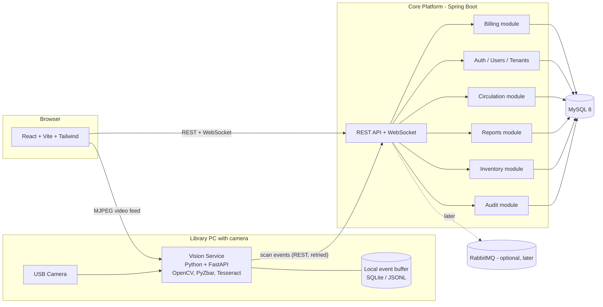

# Libro-Bot 3.0 — Master Plan
### Spring Boot Core + Python Vision Service + SaaS Layer

> **Audience:** the AI coding assistant working on this repo, and Nishanth (lead developer).
> **Written:** November 1, 2026
> **Read this whole file before writing any code.** Then follow Section 14 (working rules).

---

## 0. Context in one minute

Libro-Bot is a computer-vision library audit system. A camera scans book barcodes on shelves, the system compares them with the library database, and reports which books are **available, missing, issued, or misplaced**.

**Where we are today (Phase 1 of the old roadmap, done):**
- Python 3.8+ / Flask / Flask-SocketIO / Eventlet backend in `backend/app.py`
- OpenCV + PyZbar barcode scanning from a webcam
- Excel (`books_database.xlsx`) as the database, loaded into memory, via Pandas/OpenpyXL
- React 18 + Vite + Tailwind + Recharts + Framer Motion frontend
- Word (`.docx`) audit reports, Excel/CSV import/export, barcode label printing
- Firebase Auth with a demo bypass login
- Circulation (checkout/return) UI exists but its backend endpoints do not
- Awards: 1st Prize at UDHIYAM'26, Best Startup Idea at SREC INNOVATE

**What we are doing now (this plan):**
1. Replace the Python backend with a **Java Spring Boot core platform** (enterprise-grade, safe, maintainable).
2. Move all image recognition and ML into a **separate Python vision service**, so a crash there never takes down the platform.
3. Replace Excel-as-database with **MySQL 8**.
4. Build a **SaaS layer**: landing page, payment gateway, accounts after payment, per-customer data isolation, and strong login (2-step verification, email, phone).
5. Make the project stand out as a real startup product.

**Explicitly out of scope for now:** the handheld device (Pi CM4 / RK3566 / RFID / battery). We keep the current model: **a PC with a connected camera**. Do not design around embedded hardware yet, but do not make decisions that block it later (see the `FrameSource` abstraction in Section 5).

**Career goal:** this project is also Nishanth's main Java showcase for campus placements (December 2026). Code quality, tests, clear commits and explainable design matter as much as features.

---

## 1. Goals, non-goals, and success criteria

### Goals
- G1. The platform keeps working (CRUD, reports, dashboards) even if the vision service is down.
- G2. The vision service keeps scanning and buffers results even if the core platform is briefly down.
- G3. Every table is tenant-aware from day one, so SaaS does not require a rewrite.
- G4. One-command local start (`docker compose up`) for the whole system.
- G5. Feature parity with the current Flask app before any new feature is added.

### Non-goals (for now)
- Handheld hardware, RFID, battery, 3D enclosure
- Kubernetes, service mesh, 10+ microservices
- Native mobile apps
- Training custom ML models (use OpenCV/PyZbar/Tesseract first; ML comes after the pilot gives real data)

### Success criteria (definition of "done" for the migration, end of Phase 4)
- [ ] Every existing Flask feature works through the new stack
- [ ] Killing the vision container does not crash the core or the UI (UI shows "Scanner offline")
- [ ] Killing the core container does not lose scans (vision buffers and replays)
- [ ] 70%+ test coverage on the audit classification logic, with tests ported from the old behaviour
- [ ] README with architecture diagram, run steps, and API docs (Swagger)

---

## 2. Target architecture



### Responsibility split (the most important rule in this document)

| Concern | Owner | Rule |
| :--- | :--- | :--- |
| Seeing: camera, frames, barcode/OCR/colour decoding | **Vision service (Python)** | Perception only. It does not know about books, shelves, users or databases. |
| Deciding: is this book available, missing, misplaced, issued? | **Core platform (Java)** | The core owns all business logic and all data. |
| Showing: dashboards, tables, charts | **Frontend (React)** | Talks to the core for data; talks to the vision service only for the live video stream. |

This keeps the vision service stateless and replaceable, and keeps all business rules in Java where they are testable and showcase-worthy.

### Why a modular monolith and not microservices
Two deployable services (core and vision) is the right size. Inside the core, modules are separated by packages with clear interfaces (`inventory`, `audit`, `reports`, `circulation`, `iam`, `billing`). If one module ever needs to scale alone, it can be extracted later. Do not create more services unless there is a measured reason.

---

## 3. Tech stack

| Layer | Choice | Notes |
| :--- | :--- | :--- |
| Language / runtime | Java 21 or newer (LTS) | Use records, switch expressions, virtual threads only if justified |
| Framework | Spring Boot (latest stable, check start.spring.io) | Web, Validation, Data JPA, Security, WebSocket, Actuator |
| Build | Maven | Multi-module only if it stays simple; single module with packages is fine at first |
| Database | MySQL 8.x (InnoDB, utf8mb4) | Replaces Excel; Flyway for migrations. Use the official MySQL image, not MariaDB |
| Migrations | Flyway | Every schema change is a versioned SQL file |
| API docs | springdoc-openapi (Swagger UI) | The contract is documentation and test target |
| Excel / Word | Apache POI (XSSF for xlsx, XWPF for docx) | Replaces Pandas/OpenpyXL/python-docx |
| Resilience | Resilience4j | Timeouts, retries, circuit breaker around calls to vision |
| Realtime | Spring WebSocket (STOMP) | Replaces Socket.IO |
| Testing | JUnit 5, Mockito, Testcontainers (MySQL), MockMvc | Integration tests use a real MySQL container |
| Vision service | Python 3.11+, FastAPI, OpenCV, PyZbar, pytesseract | Kept in Python on purpose |
| Frontend | Existing React 18 + Vite + Tailwind | Swap Socket.IO client for STOMP/WebSocket client |
| Containers | Docker + Docker Compose | Healthchecks and restart policies |
| CI | GitHub Actions | Build, test, lint on every push |
| Auth (Phase 6+) | Spring Security + JWT, TOTP and email OTP | Keycloak is an alternative; decide at the start of Phase 6 and record it in an ADR |
| Payments (Phase 8) | Razorpay Subscriptions + webhooks | India-first |
| Messaging (optional) | RabbitMQ | Only if REST + buffer proves insufficient |

---

## 4. Repository layout (monorepo)

```
librobot/
├── README.md
├── docker-compose.yml
├── docs/
│   ├── architecture.md
│   ├── api-contract.md            # Section 6 lives here once finalized
│   ├── adr/                       # Architecture Decision Records (one file per decision)
│   └── runbook.md
├── core-platform/                 # Spring Boot
│   ├── pom.xml
│   └── src/main/java/com/librobot/
│       ├── LibroBotApplication.java
│       ├── common/                # errors, tenant context, utilities
│       ├── inventory/             # books, shelves, import/export
│       ├── audit/                 # sessions, scan ingestion, classification
│       ├── reports/               # docx/xlsx generation
│       ├── circulation/           # issue/return
│       ├── iam/                   # users, roles, tenants, auth
│       ├── billing/               # plans, subscriptions, webhooks
│       └── realtime/              # WebSocket publishing
│   └── src/main/resources/db/migration/   # Flyway SQL
├── vision-service/                # Python FastAPI
│   ├── requirements.txt
│   └── app/
│       ├── main.py
│       ├── camera/                # FrameSource implementations
│       ├── decoders/              # barcode, ocr, colour
│       ├── publisher.py           # sends events to core, with buffer
│       └── health.py
├── frontend/                      # existing React app, migrated
├── legacy/                        # old Flask backend kept read-only for reference
└── landing/                       # SaaS marketing site (Phase 8)
```

**Move the old Flask code into `legacy/` rather than deleting it.** It is the reference for behaviour parity, and the AI must read it before porting.

---

## 5. Camera design (important for SaaS later)

Today Flask opens the camera directly. Keep that idea: **the vision service owns the camera** and runs on the PC the camera is plugged into.

- Define an interface `FrameSource` in the vision service with implementations:
  - `UsbCameraSource` (OpenCV `VideoCapture`, index and resolution configurable). **Build this now.**
  - `BrowserUploadSource` (frames posted from the browser). **Later**, for cloud-hosted SaaS where the server cannot reach the customer's camera.
  - `RtspSource` / `HandheldSource` (network or device cameras). **Later**, including the handheld.
- The video feed for the dashboard is served by the vision service as MJPEG at `/video_feed`.
- In the SaaS model, the vision service is an **edge agent**: it runs at the customer's library and pushes scan events to the cloud core using a per-tenant API key (Phase 7). Design the publisher so the core URL and API key are configuration, not constants.

---

## 6. API contract (draft, to be finalized in `docs/api-contract.md`)

### 6.1 Vision service (FastAPI)

| Method | Path | Purpose |
| :--- | :--- | :--- |
| GET | `/health` | Liveness + camera status (`UP`, `DEGRADED`, `CAMERA_DISCONNECTED`) |
| GET | `/video_feed` | MJPEG stream with bounding boxes |
| POST | `/camera/control` | `{ "action": "START" \| "PAUSE" \| "STOP", "index": 0, "width": 640, "height": 480 }` |
| POST | `/v1/decode` | Multipart image in, decode result out (used for tests and future browser-upload mode) |
| POST | `/session` | Core tells vision which audit session id is active (so events carry it) |

**Decode result:**
```json
{
  "barcodes": [
    { "value": "9780134685991", "symbology": "CODE128", "confidence": 0.98,
      "bbox": [x, y, w, h] }
  ],
  "ocr": null,
  "colorHint": null
}
```
`ocr` and `colorHint` stay `null` until Phase 5.

### 6.2 Scan event (vision to core)

`POST {CORE_URL}/api/v1/internal/scan-events`  (header `X-Agent-Key` once tenants exist)
```json
{
  "eventId": "uuid-v4",
  "sessionId": "uuid",
  "barcode": "9780134685991",
  "symbology": "CODE128",
  "confidence": 0.98,
  "capturedAt": "2026-11-01T10:15:30Z",
  "source": "camera-0",
  "ocr": null,
  "colorHint": null
}
```
- Core responds `202 Accepted` quickly. Classification happens in core and is pushed to the UI over WebSocket.
- `eventId` is unique in the database. **Duplicates are ignored** (idempotent), so retries are safe.

### 6.3 Core platform (`/api/v1`, documented in Swagger)

| Area | Endpoints |
| :--- | :--- |
| Auth | `POST /auth/register`, `/auth/login`, `/auth/refresh`, `/auth/logout`, `/auth/verify-email`, `/auth/mfa/*` |
| Books | `GET/POST /books`, `GET/PUT/DELETE /books/{barcode}`, `POST /books/bulk-delete` |
| Import/export | `POST /books/import` (xlsx, xls, csv, ods), `POST /books/import/undo`, `GET /books/export?format=xlsx\|csv\|ods` |
| Shelves | `GET/PUT /shelves` (department to shelf map; replaces `shelf_map.json`) |
| Audit | `POST /audit-sessions`, `GET /audit-sessions/{id}`, `POST /audit-sessions/{id}/reset`, `POST /audit-sessions/{id}/close` |
| Audit results | `GET /audit-sessions/{id}/summary`, `/found`, `/missing`, `/misplaced` |
| Reports | `GET /audit-sessions/{id}/report.docx` |
| Stats | `GET /stats/overview` (KPIs, department distribution, critical flags) |
| Circulation | `POST /circulation/checkout`, `POST /circulation/return`, `GET /circulation/records` |
| Ops | `GET /actuator/health`, `/actuator/info` |

**WebSocket topics (STOMP):** `/topic/audit/{sessionId}/scans`, `/topic/audit/{sessionId}/status`, `/topic/system/vision-status`.

**Error format:** use RFC 7807 Problem Details for every error response.

---

## 7. Data model (MySQL 8)

Every business table has `tenant_id` from the first migration. In Phase 1 there is a single default tenant; Phase 7 makes it real.

| Table | Key columns | Notes |
| :--- | :--- | :--- |
| `tenants` | id, name, slug, plan, status, created_at | |
| `users` | id, tenant_id, email, password_hash, role, email_verified, phone, mfa_enabled, mfa_secret_enc, created_at | Roles: `OWNER`, `ADMIN`, `LIBRARIAN`, `AUDITOR` |
| `books` | id, tenant_id, barcode, title, author, department, status, shelf_code, created_at, updated_at | Unique on (`tenant_id`, `barcode`). `status`: `AVAILABLE`, `ISSUED` |
| `shelves` | id, tenant_id, code, department, label | Replaces `shelf_map.json` |
| `audit_sessions` | id, tenant_id, started_by, target_shelf, status, started_at, ended_at, camera_source | `status`: `ACTIVE`, `CLOSED` |
| `scan_events` | id, tenant_id, session_id, event_id (unique), barcode, detected_shelf, classification, confidence, scanned_at, source | Index on (`session_id`, `barcode`) |
| `circulation_records` | id, tenant_id, book_id, member_ref, issued_at, due_at, returned_at | |
| `import_jobs` | id, tenant_id, file_name, status, rows_ok, rows_failed, backup_ref, created_at | Powers undo-import |
| `subscriptions` | id, tenant_id, razorpay_subscription_id, plan, status, current_period_end | Phase 8 |
| `payment_events` | id, provider_event_id (unique), payload_json, processed_at | Idempotent webhooks |
| `audit_log` | id, tenant_id, actor_id, action, entity, entity_id, at | Who did what |
| `edge_agents` | id, tenant_id, name, key_hash, last_seen_at | API keys for vision agents |

### MySQL-specific rules (the AI must follow these)

- Use **MySQL 8.x**, InnoDB, `utf8mb4`. Flyway and Testcontainers both support MySQL.
- **Barcode column collation must be case-sensitive and exact:** `barcode VARCHAR(64) CHARACTER SET utf8mb4 COLLATE utf8mb4_bin`. The default collation is case-insensitive and would treat different barcodes as equal.
- Unique key on (`tenant_id`, `barcode`) as before; add indexes explicitly on `scan_events (session_id, barcode)` and `scan_events (event_id)` (unique).
- **IDs:** use `BIGINT AUTO_INCREMENT` for internal ids, and `CHAR(36)` for ids that cross service boundaries (`event_id`, `session_id`).
- **MySQL DDL is not transactional.** A failed Flyway migration can leave a half-applied change, so keep each migration file small (one logical change) and test migrations on a fresh container.
- There is no row-level security like some other databases, so **tenant isolation is enforced in application code** (Hibernate `@TenantId` or a mandatory repository filter) and proven by the cross-tenant tests in Phase 7.
- Use the `JSON` column type only for `payment_events.payload_json`; everything else stays relational.
- Docker Compose: `mysql:8` image with a named volume, a healthcheck (`mysqladmin ping`), and credentials from `.env`.
- Hibernate dialect is auto-detected on current Spring Boot; do not hard-code it unless something breaks.

**Classification enum** (port exactly from the legacy `build_status()`; do not invent new meanings): `AVAILABLE`, `MISSING`, `SAFELY_ISSUED`, `MISPLACED`, plus whatever else the legacy code defines.

---

## 8. Resilience and failure behaviour

This section is the reason for the split. Implement and test every row.

| Failure | Expected behaviour |
| :--- | :--- |
| Vision service down | Core stays fully usable. UI banner "Scanner offline". WebSocket topic `/topic/system/vision-status` reports `DOWN`. Existing session data stays visible. |
| Vision service camera disconnected | `/health` returns `CAMERA_DISCONNECTED`; vision retries with backoff (reuse the old reconnect logic); UI shows the state. |
| Core down | Vision keeps showing video and decoding. Scan events go to a **local buffer** (SQLite or JSONL, bounded to a sensible limit) and are **replayed in order** when core returns. |
| Core slow | Vision publisher uses a short timeout, bounded retries with exponential backoff, then falls back to the buffer. |
| Duplicate event delivery | Core ignores a repeated `eventId`. No double counting. |
| Database down | Core `/actuator/health` readiness fails; API returns 503 Problem Details; no stack traces leak. |
| Bad Excel import | Backup snapshot is stored first; failed rows are reported; undo restores the previous state. |
| Bad webhook (Phase 8) | Signature verification failure returns 400 and logs; no tenant changes. |

Use Resilience4j on any core-to-vision call (for example camera control), with a circuit breaker and sensible fallbacks. Add Docker `restart: unless-stopped` and healthchecks for both services.

---

## 9. Phased delivery plan

Time estimates assume focused AI-assisted work of about 2 to 3 hours per day and Nishanth reviewing every step. Placements are in December, so **Phases 0 to 4 are the priority**. Phases 5 to 9 can continue after.

### Phase 0: Preparation (2 to 3 days)
**Tasks**
- Create the monorepo structure (Section 4). Move the Flask code to `legacy/`.
- Write `docs/adr/0001-spring-boot-core-python-vision.md` (why this split).
- Read `legacy/backend/app.py` fully. Produce `docs/legacy-behaviour.md`: every endpoint, the exact `build_status()` rules, the import/dedupe rules, the report contents.
- Capture sample data: `books_database_sample.xlsx` and a few expected audit outcomes as test fixtures.
- Remove the hard-coded demo admin credentials from any file that will be public.

**Done when:** the repo builds nothing yet, but the behaviour of the old system is fully written down.

### Phase 1: Spring Boot core, parity without vision (about 1 week)
**Tasks**
1. Generate the project (Web, Validation, Data JPA, MySQL 8, Flyway, Actuator, Security, WebSocket, Lombok optional).
2. Flyway migrations for the tables in Section 7 (single default tenant).
3. `inventory` module: Book CRUD, bulk delete, shelf map endpoints.
4. Import/export with Apache POI and a CSV parser: column auto-matching, duplicate cleanup, backup snapshot, undo.
5. `audit` module: sessions, **scan-event ingestion endpoint**, classification service ported from legacy, summary/found/missing/misplaced endpoints.
6. `reports` module: the Word audit report with the same sections as legacy.
7. `stats` endpoint for the Overview page.
8. Problem Details error handling, validation, OpenAPI docs.
9. **Tests first for classification**: write characterization tests from `docs/legacy-behaviour.md` and the fixtures, then implement until they pass.

**Done when:** you can drive a full audit by sending fake scan events with curl or Postman and get correct found, missing and misplaced lists and a correct Word report.

### Phase 2: Python vision service (4 to 5 days)
**Tasks**
1. FastAPI app with `/health`, `/video_feed`, `/camera/control`, `/v1/decode`, `/session`.
2. Port the camera worker and PyZbar pipeline from legacy. Implement `UsbCameraSource` behind the `FrameSource` interface.
3. Publisher: send scan events to core with timeout, retry and backoff, and the local buffer with in-order replay.
4. Debounce repeated reads of the same barcode in a short window (do not rely on core alone).
5. Unit tests for decoding against saved sample images.

**Done when:** pointing the camera at a barcode produces one scan event in core, and stopping core then restarting it results in no lost events.

### Phase 3: Frontend migration and integration (about 1 week)
**Tasks**
1. Environment config: `VITE_API_URL` (core), `VITE_VISION_URL` (video feed).
2. Replace Socket.IO with a STOMP/WebSocket client in `socket.js`.
3. Point every page (Dashboard, Overview, Misplaced, Admin) at the new `/api/v1` endpoints.
4. Show system status: vision up or down, camera state, WebSocket connected.
5. Keep the existing look and behaviour exactly; do not redesign in this phase.
6. `docker-compose.yml` bringing up MySQL, core, vision, frontend. One command to run everything on the library PC (camera device passthrough for Linux; on Windows run the vision service natively and the rest in Docker, documented in the README).

**Done when:** the demo flow of the old app works end to end on the new stack.

### Phase 4: Hardening and the "kill test" (3 to 4 days)
**Tasks**
- Resilience4j circuit breaker and fallback for core-to-vision calls.
- Run and script the failure scenarios in Section 8 (stop vision, stop core, stop MySQL, unplug camera).
- Add GitHub Actions: build, unit tests, integration tests with Testcontainers.
- Structured logging with a correlation id across both services.
- README: architecture diagram, quick start, screenshots, a short demo GIF.

**Done when:** all Section 1 success criteria are ticked. **This is the MVP cut line.** Tag the release `v3.0-mvp`.

### Phase 5: Circulation and vision fallbacks (about 1 week)
- Circulation endpoints (`checkout`, `return`, due dates, member lookup), wire the existing UI.
- Tesseract OCR fallback for spine text when no barcode is readable. Return OCR text in the decode result; core suggests title matches (fuzzy search) for operator confirmation.
- HSV cover colour hint as a weak secondary signal only (never the sole identifier).
- Operator workflow for "unreadable book": queue it, let the librarian resolve it manually.

### Phase 6: Authentication and roles (about 1 week)
- Spring Security with JWT access tokens and refresh tokens (rotating, revocable).
- Registration, email verification, password reset, rate limiting on login.
- Roles and permissions (`OWNER`, `ADMIN`, `LIBRARIAN`, `AUDITOR`) enforced with method security.
- **MFA:** TOTP (authenticator app) and email OTP first. Phone/SMS OTP later: in India it needs DLT registration, so do not block the launch on it.
- Remove the demo bypass from production builds (keep it only behind a dev profile).
- Decision point: stay with in-house Spring Security or adopt Keycloak. Record the decision as an ADR.

### Phase 7: Multi-tenancy (about 1 week)
- Make `tenant_id` real: resolve tenant from the authenticated user, enforce it on every query (Hibernate multi-tenancy or a mandatory repository filter), and add an automated test that proves tenant A can never read tenant B's data.
- Tenant onboarding: create tenant, default shelves, default admin.
- Edge agent API keys (`edge_agents`): the vision service authenticates to the cloud core with a key.
- Plans: Starter, Pro, Institution. A dedicated database for large institutions is a **premium option**, not the default.

### Phase 8: SaaS layer (1 to 2 weeks)
- Landing site (`landing/`): product story, how it works, demo video, pricing, awards, contact/demo request.
- Razorpay Subscriptions: checkout, **webhook with signature verification and idempotency** (`payment_events`), create or activate the tenant only after a verified successful payment, handle failed payments, cancellation, grace period.
- Customer portal: subscription status, invoices link, team members, agent keys.
- Transactional emails (welcome, verification, receipts, payment failure).

### Phase 9: Production readiness (ongoing)
- Deployment on a single VPS or managed container service with HTTPS, backups of MySQL, secrets from environment or a secret manager.
- Monitoring: Actuator metrics, uptime check, error tracking.
- Security pass: dependency scanning, OWASP top 10 checklist, rate limits, audit log review.
- Data export per tenant and tenant deletion (privacy and trust).

---

## 10. Security checklist

- Never commit secrets or demo credentials. Use `.env` (gitignored) and `.env.example`.
- Passwords hashed with BCrypt or Argon2. No plaintext anywhere.
- MFA secrets encrypted at rest.
- CORS restricted to known origins.
- All inputs validated; file uploads limited by size and type; Excel import parsed defensively.
- Webhooks verified by signature; handlers idempotent.
- Tenant isolation enforced in code and covered by tests.
- Edge agent keys stored hashed; revocable.
- Rate limiting on login, OTP and public endpoints.
- No stack traces or SQL in API errors.

---

## 11. Testing strategy

| Level | What | Tools |
| :--- | :--- | :--- |
| Unit | Classification rules, import parsing, report building | JUnit 5, Mockito |
| Integration | Controllers + real MySQL | Spring Boot Test, Testcontainers, MockMvc |
| Contract | Scan event JSON between vision and core | Shared JSON schema, test on both sides |
| Resilience | Kill/restart scenarios from Section 8 | Scripted with Docker Compose |
| Tenant isolation | Cross-tenant access attempts return 404/403 | Dedicated test suite from Phase 7 |
| Vision | Decode sample images, buffer replay ordering | pytest |

**Rule:** the classification logic gets tests before implementation. It is the heart of the product.

---

## 12. Features that make this a startup, not just a project

Ranked by value for effort.

1. **Pilot data.** Run a real audit in the SREC library and record: books scanned, time taken, accuracy, versus the manual 3 to 5 days. A measured result is the strongest sales and funding asset.
2. **Library system integration.** Many Indian college libraries use Koha or SOUL. Import/export adapters for them mean libraries do not have to switch systems.
3. **Accreditation-ready reports (NAAC/NBA).** One-click stock verification report formatted for audits. This is a clear reason for a college to pay.
4. **Analytics.** Loss trends, shelf heatmaps, sections that lose the most books, books never circulated.
5. **Audit scheduling and alerts.** Weekly shelf checks with email summaries.
6. **Offline-first operator mode.** If WiFi drops mid-audit, nothing is lost (the buffer in Section 8 is the first step).
7. **Multi-site support.** One institution, several libraries or branches.
8. **Label service.** Generate and print barcode label sheets for books that have no barcode (already built; polish it).
9. **Adjacent markets.** School libraries, bookstores, archives, small retail stock checks.
10. **Business model.** Per-library subscription, with an optional device lease later when the handheld returns. Easier for colleges to approve than a large upfront cost.
11. **Validate before scaling.** Get 2 to 3 libraries to agree to pay or sign a letter of intent before heavy investment in billing features.
12. **Later: ML.** Once real shelf images exist, train models for spine detection and damaged-label reading. Do not start here.

---

## 13. Risks and mitigations

| Risk | Mitigation |
| :--- | :--- |
| Scope is large; placements are close | Treat Phase 4 as the MVP line; everything after is optional until then |
| Behaviour drifts from the Flask version | Phase 0 behaviour doc and characterization tests |
| Windows camera access in Docker | Run the vision service natively on Windows; document it; use Compose for the rest |
| SMS OTP in India needs DLT registration | Launch with email OTP and TOTP; add SMS later |
| Per-tenant databases become expensive | Shared schema with `tenant_id` first; dedicated DB only as a premium tier |
| AI generates code Nishanth cannot explain | Working rules in Section 14 |
| Payment edge cases (retries, failures) | Idempotent webhooks, `payment_events` table, test with Razorpay test mode |

---

## 14. Working rules for the AI assistant

1. **Read first, then plan, then code.** For each phase, restate the tasks and the acceptance criteria before writing anything.
2. **Small steps.** One task at a time, each ending in something runnable or testable. No giant multi-module dumps.
3. **Explain as you go.** For each new concept (JPA entity mapping, Flyway, Spring Security filters, Resilience4j, STOMP) give a short explanation of *why* it is used here. Nishanth needs to be able to explain every module in a placement interview.
4. **Pause for review.** After each task, summarize what changed and what to check. Nishanth reviews and runs it before continuing.
5. **Tests with the code.** Do not mark a task done without tests for its main behaviour.
6. **Git discipline.** Small commits with clear messages (`feat(audit): ...`, `fix(import): ...`), one branch per phase, push to GitHub from the start. The commit history is part of the portfolio.
7. **Record decisions.** Anything that was a real choice gets a short ADR in `docs/adr/`.
8. **Do not invent behaviour.** If the legacy code or this plan is unclear, ask instead of guessing, especially for classification rules.
9. **Never commit secrets** or demo credentials.
10. **Keep it boring and consistent.** Standard Spring conventions, DTOs at the API boundary (not entities), constructor injection, layered packages by module.

### Prompt to paste at the start of each session
```
Read LIBROBOT_MASTER_PLAN.md. We are on Phase <N>, task <X>.
Restate the task and acceptance criteria, list the files you will touch,
then wait for my go-ahead. Explain new concepts briefly. After coding,
give me a checklist to verify before we continue.
```

---

## 15. Open questions (answer before or during Phase 0)

1. Exactly which classifications exist in legacy `build_status()`, and how is "misplaced" decided when no target shelf is selected?
2. Should an audit session be per shelf, per department, or free-form?
3. Is the first customer the SREC library only, or a few libraries from the start (affects how early tenancy must be real)?
4. In-house auth (Spring Security + JWT) or Keycloak? Decide at the start of Phase 6.
5. Where will the cloud core be hosted for the pilot (single VPS, or a managed service)?
6. Which member identifier does circulation use (student ID, email, both)?

---

## 16. Master checklist

- [ ] Phase 0: legacy behaviour documented, repo restructured
- [ ] Phase 1: Spring Boot core with MySQL at parity
- [ ] Phase 2: Python vision service with buffered publishing
- [ ] Phase 3: Frontend migrated, one-command run
- [ ] Phase 4: Kill tests pass, CI green, `v3.0-mvp` tagged
- [ ] Phase 5: Circulation, OCR fallback, colour hint
- [ ] Phase 6: Auth, roles, MFA
- [ ] Phase 7: Real multi-tenancy with isolation tests
- [ ] Phase 8: Landing page, Razorpay, customer portal
- [ ] Phase 9: Production deployment, monitoring, security pass

*End of plan. Update this file as decisions change; it is the single source of truth for the AI assistant.*
